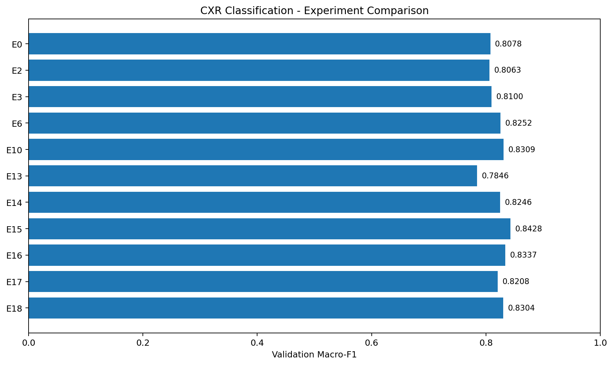
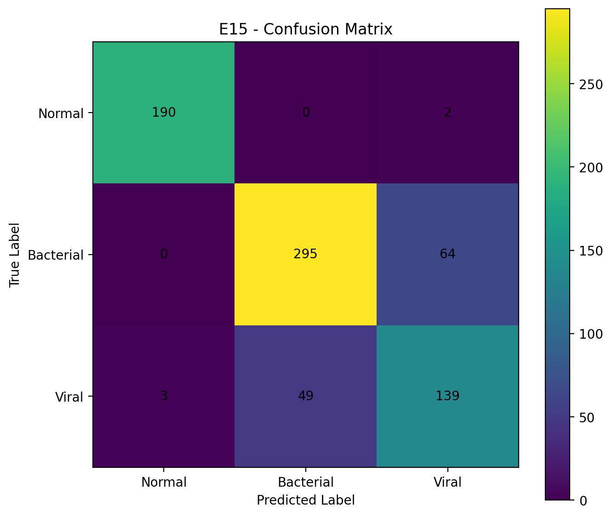

# Chest X-ray Pneumonia Classification

흉부 X-ray 영상 기반 3-class 폐렴 분류 프로젝트입니다.

단순한 분류 성능 개선뿐 아니라 다양한 손실함수,
학습 전략, 모델 구조 및 특징 표현 방식을 비교하고
각 접근법의 장단점과 한계를 분석하는 것을 목표로 합니다.

## Classification Task

- NORMAL
- BACTERIAL_PNEUMONIA
- VIRAL_PNEUMONIA

## Research Objectives

1. CNN 기반 baseline 구축
2. Loss Function 및 Contrastive Learning 실험
3. Hierarchical Classification 구조 검증
4. RAD-DINO 기반 의료영상 특징 표현 활용
5. Attention 및 Feature Fusion 구조 비교
6. 모델 성능과 오류 원인 분석

## Experiments

| Experiment | Research Direction |
|------------|--------------------|
| E0 | Baseline |
| E1-E9 | Loss Function & Contrastive Learning |
| E10-E12 | Hierarchical Classification & Routing |
| E13 | RAD-DINO Linear Probe |
| E14 | RAD-DINO Patch Specialist |
| E15 | RAD-DINO Last-Block Fine-tuning |
| E16 | Global-Local Feature Fusion |
| E17 | RAD-DINO Pyramid Pooling |
| E18 | CNN-RAD-DINO Residual Fusion |
| E19 | CNN-only Group Cross-Validation |

## Final Model

주요 실험에서 E15를 최종 선정 모델로 사용했습니다.

E16-E19는 추가적인 구조 비교 및 검증 실험으로
구분하여 기록합니다.

## Project Structure

- configs/: Experiment configurations
- scripts/: Training, evaluation and analysis scripts
- src/p1_cxr/: Model architectures and training modules
- src/data/: Data loading and preprocessing
- demo/: Web demo application
- docs/: Project documentation

## Results & Analysis

### Selected Model Performance

| Model | Validation Macro-F1 |
|---|---:|
| E6 - Focal Loss | 0.8252 |
| E10 - Hierarchical Classification | 0.8309 |
| **E15 - RAD-DINO Fine-tuning** | **0.8428** |

The E15 score represents the Normal-preserving
three-class classification pipeline.

### Experiment Comparison

See the detailed results and research analysis:

- [Experiment Results](docs/experiment_results.md)
- [Model Architecture](docs/model_architecture.md)
- [Key Findings](docs/key_findings.md)

E19 uses binary Bacterial/Viral cross-validation
and is reported separately.

All reported scores are research validation metrics,
not independent clinical test results.

### E15 Confusion Matrix

The primary remaining challenge is distinguishing
Bacterial from Viral pneumonia.

## Evaluation

- Macro-F1
- Class-wise Precision / Recall / F1
- Confusion Matrix
- Error Analysis

실험별 수치와 세부 평가 결과는 검증된
실험 산출물을 기준으로 관리합니다.

## Data

Chest X-ray 영상 데이터를 사용합니다.

데이터 누수 위험을 고려하여 분할 및 평가 전략을
검토하였으며, 공식 test 데이터는 개발 과정의
모델 선택에 사용하지 않는 것을 원칙으로 합니다.

원본 영상 데이터 및 대용량 모델 체크포인트는
GitHub 저장소에 포함하지 않습니다.

## Demo

웹 데모 관련 소스코드는 demo/ 디렉터리에
보관합니다.

## Disclaimer

본 프로젝트는 교육 및 연구 목적이며,
실제 임상 진단을 위한 의료기기가 아닙니다.
